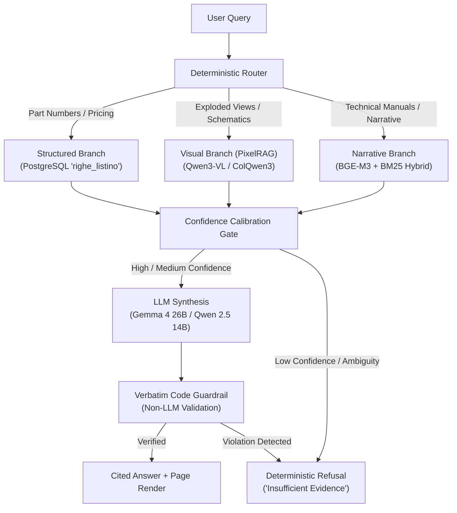

# 🏭 AI Knowledge Engine — Vertical Hybrid RAG for Manufacturing

[](https://www.python.org/downloads/)
[](https://langchain-ai.github.io/langgraph/)
[](https://qdrant.tech/)
[](https://github.com/astral-sh/ruff)
[]()

> **An experimental architecture, empirical benchmark, and failure mode analysis for domain-specific RAG on industrial technical manuals, spare parts catalogs, and mechanical exploded views.**

---

## 📌 Executive Summary

Retrieval-Augmented Generation (RAG) on technical manufacturing documentation presents challenges that standard naive RAG pipelines cannot solve:
1. **Part Number Precision:** A single mismatched alphanumeric character (e.g., `AF02110000E4` vs `AF02110000E5`) can halt an assembly line or order the wrong replacement unit.
2. **Dense Multimodal Layouts:** Catalogs combine unstructured text, tabular price lists, and visual exploded diagrams on identical page templates.
3. **Zero-Hallucination Mandate:** The system **must be provably correct or explicitly declare "I don't know"** — never hallucinate a plausible code. Every cited fact must point directly to its source document and page.

This repository documents the design, implementation, and empirical evaluation of an air-gapped, local **Tri-Intent LangGraph FSM** built for Apple Silicon (Mac M1/M2 32GB RAM).

---

## 🏛 Architecture Overview

The system classifies user queries deterministically into three specialized retrieval branches:



### Key Engineering Features
* **Deterministic Code Guardrail (Non-LLM):** Any part number cited in the final synthesis must exist *verbatim* in the retrieved chunk evidence. If the LLM generates a part code not present in the recovered text, the guardrail rejects the response immediately.
* **Strict Confidence Gating:** Evaluates the score margin between top candidates. If duplicate rows generate identical scores (margin $= 0.00$), the system defaults to safe refusal rather than guessing.
* **Granular Role-Based Access Control (RBAC):** Document-level filtering (Technician, Commercial, Administration) enforced at vector search time via Qdrant payload filters.
* **Model Memory Multiplexer:** Custom runtime memory management with eviction and clamp routines to run 26B parameter models within a 32GB unified memory envelope.

---

## 🔬 Empirical Findings & Failure Modes (The "Hard Lessons")

Unlike standard benchmarks that report artificially high retrieval scores on clean prose, our stress tests across 140+ real-world industrial technical PDFs (Italian, English, German) exposed critical bottlenecks:

### 1. The BM25 vs. Semantic Dilemma
* **The Problem:** Relying heavily on BM25 is essential to prevent alphanumeric code corruption, but it cripples natural language queries across languages. For example, an Italian query (*"spinotto pistone"*) against an English manual (*"piston pin"*) produced a BM25 score of $0.0$.
* **The Consequence:** The dense semantic embedding (BGE-M3) alone could not overcome the strict confidence threshold, causing false-negative refusals (*"Insufficient evidence"*).
* **The Lesson:** Technical RAG requires dedicated bilingual domain thesauri and query expansion prior to lexical indexing.

### 2. Table Extraction & Layout Fragmentation
* Complex nested tables without explicit cell borders (frequent in hydraulic and automotive catalogs) caused layout engines (Docling / OCR) to merge adjacent cells or truncate pages.
* If a code is dropped during ingestion, the downstream deterministic guardrail blocks the LLM from synthesizing an answer, making entire document sections invisible.

### 3. Visual Retrieval Ambiguity in Exploded Views
* Visual embedding models (ColQwen3 / Qwen3-VL) struggle when consecutive catalog pages share identical layout geometry (e.g., motor assembly diagram vs. transmission diagram both show exploded drawings with bottom tables).
* Evaluation on visual queries yielded `Recall@1` between **33.3% and 42.1%**, proving that visual embeddings alone without text-anchor fusion are insufficient for production assembly lookups.

---

## 📂 Repository Structure

```
AI-memorySystem/
├── src/
│   ├── graph/             # 1300+ line LangGraph FSM pipeline & routing
│   ├── retrieval/         # Hybrid search, reranking, confidence gates, PixelRAG
│   ├── ingestion/         # Table extractors, part code normalizers, defensive chunking
│   ├── registry/          # PostgreSQL document registry, RBAC & versioning
│   ├── serving/           # Model memory multiplexer (eviction/clamping for 32GB RAM)
│   └── ui/                # Chainlit interface with page citation rendering
├── tests/                 # 139 test files (~22,000 lines of unit & integration tests)
│   ├── eval/              # Auto-check metrics, truth sets, and runner
│   └── ui/                # RBAC and session tests
├── docker/                # Qdrant, PostgreSQL, and SearXNG orchestration
├── data/                  # Golden truth datasets and evaluation benchmarks
└── docs/                  # In-depth architectural specifications and audit logs
```

---

## 🧭 Codebase Tour (Where to Look)

If you are exploring the engineering decisions behind this system, start with these key modules:

| Path | Purpose & Architectural Significance |
|---|---|
| [`src/graph/pipeline.py`](src/graph/pipeline.py) | **The Core Brain:** 1300+ line LangGraph finite-state machine coordinating router, expansion, retrieval, confidence calibration, synthesis, and guardrails. |
| [`src/retrieval/guardrail.py`](src/retrieval/guardrail.py) | **Zero-Hallucination Enforcer:** Non-LLM deterministic validation that verifies every single cited part number exists literally in recovered evidence. |
| [`src/retrieval/confidence.py`](src/retrieval/confidence.py) | **Confidence Calibrator:** Margin-based ambiguity resolution (ALTA, MEDIA, BASSA). Rejects queries when duplicate rows yield margin $= 0.00$. |
| [`src/graph/llm.py`](src/graph/llm.py) | **Universal LLM Port:** `LanguageModel` protocol supporting local MLX/Ollama, cloud APIs (OpenAI, Gemini, Anthropic), and offline deterministic `MockModel`. |
| [`src/serving/session_deps.py`](src/serving/session_deps.py) | **Resource Manager:** Shared singletons, model multiplexer, and automatic LLM provider detection. |
| [`src/registry/access.py`](src/registry/access.py) | **RBAC Engine:** Pre-retrieval role-based access filtering (technician, commercial, administration). |

---

## 🚀 Getting Started (Quick Tour)

### 1. Setup Environment
```bash
# Clone and install dependencies with uv
git clone https://github.com/your-username/ai-knowledge-engine.git
cd ai-knowledge-engine
uv sync --extra dev
```

### 2. Configure Providers (.env)
```bash
cp .env.example .env
# To run without local 20GB models, you can:
# a) Set AIKE_LLM_PROVIDER=mock (Zero-cost demo mode)
# b) Or set OPENAI_API_KEY=... / GEMINI_API_KEY=... for cloud synthesis
```

### 3. Run Quality Checks & Tests
```bash
# Fast linting with Ruff
uv run ruff check src/

# Run unit and evaluation test suite
uv run pytest tests/common/ tests/eval/ -v
```

---

## 🛠 Tech Stack

* **Language:** Python 3.11+ (Managed with [`uv`](https://docs.astral.sh/uv/))
* **Pipeline Orchestration:** LangGraph, Pydantic v2
* **Storage & Indexing:** Qdrant (Hybrid sparse/dense), PostgreSQL 17
* **Embeddings:** BGE-M3 (Dense), BM25 (Sparse), Qwen3-VL / ColQwen3 (Visual)
* **Frontend:** Chainlit
* **Code Quality & Testing:** Ruff, Pytest (139 test modules)

---

## ⚖️ License & Attribution

Designed and developed by **Andrea Galassi**. Released under the **GNU General Public License v3.0** (see [`LICENSE`](LICENSE)).
